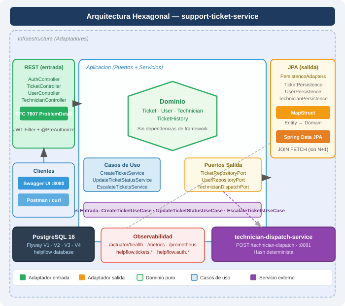
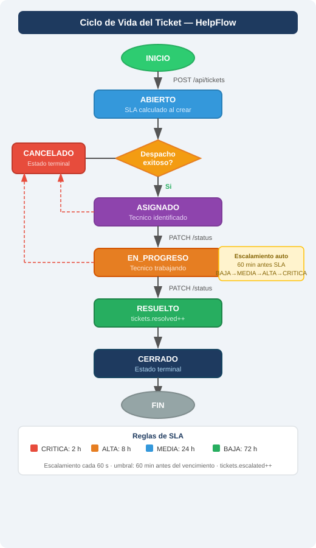
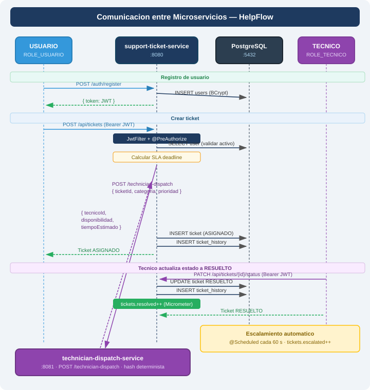

# HelpFlow — Support Ticket System

> **Módulo 6 — Prueba de Desempeño**  
> Sistema de gestión de tickets de soporte TI construido con Spring Boot,
> arquitectura hexagonal y dos microservicios independientes.

---

## Table of Contents

1. [Overview](#overview)
2. [Architecture](#architecture)
3. [Services](#services)
4. [Domain Model](#domain-model)
5. [Ticket Lifecycle](#ticket-lifecycle)
6. [SLA Rules](#sla-rules)
7. [Security Model](#security-model)
8. [API Reference](#api-reference)
9. [Inter-service Communication](#inter-service-communication)
10. [Persistence](#persistence)
11. [Observability](#observability)
12. [Running with Docker Compose](#running-with-docker-compose)
13. [Local Development](#local-development)
14. [Seed Data](#seed-data)
15. [Running Tests](#running-tests)
16. [Diagrams](#diagrams)
17. [Design Decisions](#design-decisions)

---

## Overview

HelpFlow es una plataforma de soporte técnico que permite a los usuarios
registrar tickets de incidencia, a los técnicos gestionarlos, y a los
administradores supervisar y reasignar. El sistema calcula fechas límite de SLA
según la prioridad, consulta la disponibilidad de técnicos a través de un
servicio separado, y escala automáticamente los tickets que se acercan al
vencimiento.

**Tecnologías principales:**

| Componente | Versión |
|---|---|
| Java | 17 (Docker) / 21 (local) |
| Spring Boot | 3.3.0 |
| PostgreSQL | 16 |
| Flyway | incluido en Spring Boot 3.3 |
| springdoc-openapi | 2.5.0 |
| MapStruct | 1.5.5.Final |
| jjwt | 0.12.6 |
| Testcontainers | 1.20.4 |
| Docker Compose | v2 |

---

## Architecture

El `support-ticket-service` sigue **arquitectura hexagonal** (Ports & Adapters):

```
support-ticket-service/
├── domain/                          ← Núcleo. Sin dependencias de framework.
│   ├── model/                       ← Ticket, User, Technician, TicketHistory
│   │   └── enums/                   ← TicketStatus, TicketPriority, TicketCategory, Role, UserStatus
│   └── exception/                   ← DomainException, BusinessRuleException, InvalidTicketTransitionException…
│
├── application/
│   ├── port/in/                     ← Interfaces de casos de uso (CreateTicketUseCase, etc.)
│   └── port/out/                    ← Interfaces de repositorios y servicios externos
│   └── service/                     ← Implementaciones de casos de uso
│
└── infrastructure/
    ├── adapter/in/rest/             ← Controllers REST, DTOs, GlobalExceptionHandler (RFC 7807)
    ├── adapter/out/persistence/     ← JPA entities, Spring Data repos, MapStruct mappers
    ├── adapter/out/dispatch/        ← Cliente HTTP al servicio de despacho
    ├── config/                      ← SecurityConfig, OpenApiConfig, SlaConfig, MetricsConfig
    └── security/                    ← JwtService, JwtAuthenticationFilter, UserDetailsServiceImpl
```

Ver diagrama visual: [`docs/architecture-hexagonal.svg`](docs/architecture-hexagonal.svg)

### Principios aplicados

- El **dominio** no importa Spring, JPA ni ningún framework.
- Los **puertos de entrada** (`port/in`) son interfaces que los controllers llaman.
- Los **puertos de salida** (`port/out`) son interfaces que los servicios llaman; JPA las implementa.
- Los **adaptadores** traducen entre el mundo externo y el dominio mediante MapStruct.
- La **seguridad por roles** se aplica exclusivamente con `@PreAuthorize` en cada método, no en el `SecurityFilterChain` (evita conflictos de orden en Spring Security 6).

---

## Services

| Servicio | Puerto | Descripción |
|---|---|---|
| `support-ticket-service` | 8080 | API principal: tickets, usuarios, técnicos, JWT, SLA, métricas |
| `technician-dispatch-service` | 8081 | Disponibilidad simulada de técnicos. Sin JPA ni seguridad. |
| PostgreSQL 16 | 5432 | Base de datos relacional. Migraciones Flyway V1–V4. |

---

## Domain Model

### Entidades principales

**Ticket**
- `id`, `userId`, `title`, `description`, `category`, `priority`
- `sede`, `affectedAsset`, `createdAt`, `slaDeadline`
- `status`, `assignedTechnicianId`
- Método `transitionTo(newStatus)` — valida transiciones y lanza `InvalidTicketTransitionException`
- Método `isNearSlaDeadline(thresholdMinutes)` — usado por el escalamiento automático

**User**
- `id`, `document` (único), `name`, `email` (único), `password` (BCrypt)
- `sede`, `area`, `status` (ACTIVO/INACTIVO), `role`

**Technician**
- `id`, `document` (único), `name`, `salary`, `affiliationDate`
- `status`, `sede`, `specialties` (Set de TicketCategory), `supportProfile`

**TicketHistory**
- `ticketId`, `previousStatus`, `newStatus`, `observation`, `changedBy`, `changedAt`
- Registro inmutable de cada cambio de estado

### Valores de dominio

```
TicketCategory : HARDWARE | SOFTWARE | RED | ACCESOS | OTRO
TicketPriority : BAJA | MEDIA | ALTA | CRÍTICA
TicketStatus   : ABIERTO | ASIGNADO | EN_PROGRESO | RESUELTO | CERRADO | CANCELADO
Role           : ROLE_USUARIO | ROLE_TECNICO | ROLE_ADMIN
UserStatus     : ACTIVO | INACTIVO
```

### Relaciones

```
User      1 ──< N   Ticket
Ticket    1 ──< N   TicketHistory
Ticket    N >── 1   Technician  (nullable — puede no estar asignado)
Technician 1 ──< N  TechnicianSpecialties  (@ElementCollection)
```

---

## Ticket Lifecycle

```
                    POST /api/tickets
                           │
                           ▼
                        ABIERTO  ──────────────────────────────► CANCELADO
                           │                                          ▲
                  Despacho exitoso                                    │
                           │                                          │
                           ▼                                          │
                        ASIGNADO ────────────────────────────────────►│
                           │                                          │
                  PATCH /status (TECNICO)                             │
                           │                                          │
                           ▼                                          │
                      EN_PROGRESO ──────────────────────────────────►│
                           │
                  PATCH /status (TECNICO)
                           │
                           ▼
                        RESUELTO  (tickets.resolved++)
                           │
                  PATCH /status (ADMIN)
                           │
                           ▼
                        CERRADO  ◄─── estado terminal
```

Cada transición inválida devuelve **HTTP 422** con RFC 7807 ProblemDetail.

Ver diagrama visual: [`docs/ticket-lifecycle.svg`](docs/ticket-lifecycle.svg)

---

## SLA Rules

Las fechas límite se calculan al crear el ticket según la prioridad:

| Prioridad | Horas SLA | Umbral de escalamiento |
|---|---|---|
| BAJA | 72 h | 60 min antes del vencimiento |
| MEDIA | 24 h | 60 min antes del vencimiento |
| ALTA | 8 h | 60 min antes del vencimiento |
| CRÍTICA | 2 h | No escala (ya es máxima) |

**Escalamiento automático:**
- `@Scheduled` cada 60 segundos (configurable con `helpflow.sla.escalation-check-ms`)
- Si un ticket está dentro del umbral y no es CRÍTICA: sube la prioridad un nivel
- Registra en `ticket_history` con `changedBy = "SYSTEM"`
- Incrementa el contador `helpflow.tickets.escalated`

**Todos los valores de SLA son configurables** en `application.yml` bajo `helpflow.sla.*`. No hay valores hardcodeados en el código de dominio.

---

## Security Model

### JWT stateless

- Login: `POST /auth/login` → devuelve token JWT (expira en 120 min por defecto)
- Cada request protegido debe incluir: `Authorization: Bearer <token>`
- `JwtAuthenticationFilter` extrae el usuario del token y lo pone en `SecurityContextHolder`
- No hay sesión del lado del servidor (`SessionCreationPolicy.STATELESS`)

### Roles y acceso

| Rol | Puede hacer |
|---|---|
| `ROLE_USUARIO` | Registrar, iniciar sesión, crear tickets, ver **solo sus propios tickets** |
| `ROLE_TECNICO` | Ver tickets asignados, actualizar estado de tickets asignados, ver técnicos |
| `ROLE_ADMIN` | Acceso completo: todos los tickets, todos los usuarios, reasignación, configuración |

### Reglas por endpoint

| Método | Ruta | Rol requerido | Restricción adicional |
|---|---|---|---|
| POST | `/auth/register` | público | — |
| POST | `/auth/login` | público | — |
| POST | `/api/tickets` | USUARIO, ADMIN | Usuario debe estar ACTIVO |
| GET | `/api/tickets/my` | USUARIO, ADMIN | Solo retorna tickets del usuario autenticado |
| GET | `/api/tickets` | ADMIN | Todos los tickets |
| GET | `/api/tickets/{id}` | autenticado | USUARIO: solo si es el dueño; ADMIN/TECNICO: cualquiera |
| PATCH | `/api/tickets/{id}/status` | TECNICO, ADMIN | Transición debe ser válida |
| GET | `/api/users` | ADMIN | — |
| GET | `/api/users/{id}` | ADMIN | — |
| GET | `/api/technicians` | ADMIN | — |
| GET | `/api/technicians/{id}` | ADMIN, TECNICO | — |

### Arquitectura de seguridad

```
Request entrante
      │
      ▼
JwtAuthenticationFilter          ← extrae y valida el token
      │
      ▼
SecurityFilterChain              ← solo verifica autenticación (cualquier JWT válido)
      │
      ▼
@PreAuthorize en cada método     ← controla los roles (ROLE_ADMIN, ROLE_TECNICO, ROLE_USUARIO)
      │
      ▼
Lógica de propiedad en código    ← USUARIO solo puede ver sus propios tickets
```

**Por qué esta separación:** Spring Security 6 evalúa las reglas de URL en orden estricto. Tener reglas de rol tanto en `SecurityFilterChain` como en `@PreAuthorize` puede generar conflictos de orden (bug real que causaba el 403 en `GET /api/tickets/my`). La solución adoptada: el `SecurityFilterChain` solo controla autenticación vs. rutas públicas; los roles se controlan exclusivamente con `@PreAuthorize`.

### Swagger / OpenAPI

El botón **Authorize** aparece en Swagger UI porque `OpenApiConfig` registra el esquema `bearerAuth` (HTTP Bearer JWT) como `SecurityRequirement` global. Para usarlo:

1. Hacer `POST /auth/login` y copiar el `token` de la respuesta
2. Hacer clic en **Authorize** en la parte superior de Swagger UI
3. Pegar el token en el campo `bearerAuth` (sin el prefijo `Bearer`)
4. Confirmar — todas las solicitudes siguientes incluirán el header automáticamente

---

## API Reference

### POST /auth/register

Registra un nuevo usuario y devuelve un JWT.

```json
// Request
{
  "document": "CC12345678",
  "name": "Ana García",
  "email": "ana@empresa.com",
  "password": "MiPassword123!",
  "sede": "Bogotá",
  "area": "Contabilidad",
  "role": "ROLE_USUARIO"
}

// Response 200
{
  "token": "<jwt>",
  "email": "ana@empresa.com",
  "role": "ROLE_USUARIO"
}
```

### POST /auth/login

```json
// Request
{ "email": "ana@empresa.com", "password": "MiPassword123!" }

// Response 200
{ "token": "<jwt>", "email": "ana@empresa.com", "role": "ROLE_USUARIO" }
```

### POST /api/tickets *(USUARIO, ADMIN)*

```json
// Request
{
  "title": "PC no enciende",
  "description": "La PC del puesto 12 no arranca desde esta mañana",
  "category": "HARDWARE",
  "priority": "ALTA",
  "sede": "Bogotá",
  "affectedAsset": "PC-BOG-012"
}

// Response 200 — ticket creado y asignado (si dispatch disponible)
{
  "id": 1,
  "userId": 3,
  "title": "PC no enciende",
  "category": "HARDWARE",
  "priority": "ALTA",
  "status": "ASIGNADO",
  "slaDeadline": "2026-10-28T06:00:00Z",
  "assignedTechnicianId": 1
}
```

### PATCH /api/tickets/{id}/status *(TECNICO, ADMIN)*

```json
// Request
{ "newStatus": "EN_PROGRESO", "observation": "Revisando hardware" }

// Response 200 — ticket actualizado
```

### Errores — RFC 7807 ProblemDetail

Todos los errores siguen este formato:

```json
{
  "type": "about:blank",
  "title": "Invalid State Transition",
  "status": 422,
  "detail": "Cannot transition from CERRADO to EN_PROGRESO",
  "instance": "/api/tickets/5/status",
  "timestamp": "2026-10-27T20:15:00Z",
  "traceId": "3fa85f64-5717-4562-b3fc-2c963f66afa6"
}
```

| Código | Cuándo ocurre |
|---|---|
| 400 | Validación de Bean Validation falla (campo requerido, formato inválido) |
| 401 | Sin token o token expirado |
| 403 | Rol insuficiente o acceso a ticket ajeno |
| 404 | Ticket, usuario o técnico no encontrado |
| 422 | Transición de estado inválida o regla de negocio violada |
| 500 | Error inesperado (se registra con `log.error`) |

---

## Inter-service Communication

```
Cliente
  │
  │  POST /api/tickets  (Bearer JWT)
  ▼
support-ticket-service :8080
  │
  │  1. Valida usuario activo  →  PostgreSQL
  │  2. Calcula SLA deadline
  │  3. Llama al servicio de despacho  ─────────────────────────────────────►
  │                                    POST /technician-dispatch              │
  │                                    { ticketId, categoria, prioridad }     │
  │                                                                           ▼
  │                                                            technician-dispatch-service :8081
  │                                                            Hash determinista (ticketId+cat+prio)
  │                                                            → mismo input = mismo técnico siempre
  │  4. Recibe: tecnicoId, disponibilidad, tiempoEstimadoHoras  ◄─────────────
  │  5. INSERT ticket (ASIGNADO) + INSERT ticket_history  →  PostgreSQL
  │  6. tickets.created++ (Micrometer)
  ▼
Response al cliente  { ticket ASIGNADO }
```

**Resilencia:** si el servicio de despacho no responde, el ticket se crea como
`ABIERTO` sin asignación. No hay `@CircuitBreaker` explícito; el error se captura
en `TechnicianDispatchAdapter` y se propaga como `RuntimeException`, que
`CreateTicketService` maneja dejando el ticket en `ABIERTO`.

**Determinismo:** el servicio de despacho calcula un hash de `ticketId + categoria + prioridad`.
La misma combinación siempre devuelve el mismo técnico y tiempo estimado.

**Clasificación de disponibilidad:**
- 0–2 horas → ALTA
- 3–8 horas → MEDIA
- Más de 8 horas → BAJA

Ver diagrama visual: [`docs/microservices-communication.svg`](docs/microservices-communication.svg)

---

## Persistence

### Esquema (Flyway)

| Migración | Contenido |
|---|---|
| `V1__schema.sql` | Tablas `users`, `technicians`, `technician_specialties`, `tickets` |
| `V2__asignaciones_historial_sla.sql` | Tabla `ticket_history`, índices en `user_id`, `technician_id`, `status`, `sla_deadline` |
| `V3__datos_iniciales.sql` | Usuarios y técnico seed (admin, tecnico, usuario) |
| `V4__fix_seed_passwords.sql` | Actualiza hashes BCrypt de los usuarios seed |

### Estrategia N+1

Las queries de lista usan `LEFT JOIN FETCH` explícito para evitar el problema N+1:

```java
// JpaTicketRepository — consultas con JOIN FETCH
@Query("SELECT t FROM TicketEntity t LEFT JOIN FETCH t.user LEFT JOIN FETCH t.technician WHERE t.user.id = :userId")
List<TicketEntity> findByUserId(@Param("userId") Long userId);

@Query("SELECT t FROM TicketEntity t LEFT JOIN FETCH t.user LEFT JOIN FETCH t.technician")
List<TicketEntity> findAll();
```

Adicionalmente, `TicketEntity` tiene `@NamedEntityGraph` para cargar el historial
cuando se necesita.

### Transaccionalidad

`CreateTicketService.create()` y `UpdateTicketStatusService.updateStatus()` están
anotados con `@Transactional`. El `INSERT` del ticket y el `INSERT` del historial
ocurren en la misma transacción — si cualquiera falla, se hace rollback completo.

---

## Observability

### Health checks

```bash
# Estado general
curl http://localhost:8080/actuator/health

# Liveness (para Kubernetes / Docker healthcheck)
curl http://localhost:8080/actuator/health/liveness

# Readiness
curl http://localhost:8080/actuator/health/readiness
```

### Métricas de negocio

Todas las métricas usan etiquetas de baja cardinalidad (sin IDs de tickets ni usuarios).

| Métrica | Tipo | Cuándo se incrementa |
|---|---|---|
| `helpflow.tickets.created` | Counter | Cada vez que se crea un ticket exitosamente |
| `helpflow.tickets.escalated` | Counter | Cada ticket escalado por el scheduler de SLA |
| `helpflow.tickets.resolved` | Counter | Cada vez que un ticket pasa a estado RESUELTO |
| `helpflow.dispatch.calls` | Counter | Cada llamada al servicio de despacho |
| `helpflow.auth.failures` | Counter | Cada `AuthenticationException` en el handler global |
| `helpflow.access.denied` | Counter | Cada `AccessDeniedException` en el handler global |

```bash
# Ver todas las métricas HelpFlow
curl http://localhost:8080/actuator/metrics | python -m json.tool | grep helpflow

# Ver un contador específico
curl http://localhost:8080/actuator/metrics/helpflow.tickets.created

# Formato Prometheus
curl http://localhost:8080/actuator/prometheus | grep helpflow
```

### Evidencia de métricas en funcionamiento

Para generar actividad real en los contadores:

```bash
# 1. Login exitoso + crear ticket → tickets.created se incrementa
# 2. Intentar acceder a /api/tickets sin token → auth.failures no sube (401 viene del filtro, no del handler)
# 3. Usar token de ROLE_USUARIO en GET /api/tickets → access.denied sube
# 4. Esperar 60s con un ticket cerca del SLA → tickets.escalated sube
# 5. Llevar ticket a RESUELTO → tickets.resolved sube
```

---

## Running with Docker Compose

### Requisitos previos

- Docker Desktop instalado y activo
- Puerto 5432, 8080 y 8081 disponibles

### Inicio rápido

```bash
# 1. Copiar el archivo de entorno
cp .env.example .env

# 2. Editar .env — establecer un JWT_SECRET fuerte (mínimo 32 caracteres)
# Nunca subir .env al control de versiones

# 3. Levantar todos los servicios
docker compose up --build

# 4. Verificar que todo está healthy
docker compose ps

# 5. Swagger UI del servicio principal
open http://localhost:8080/swagger-ui.html

# 6. Swagger UI del servicio de despacho
open http://localhost:8081/swagger-ui.html
```

### Rebuild sin perder datos

Si solo cambió el código de `support-ticket-service`:

```bash
# Reconstruir solo la imagen
docker compose build support-ticket-service

# Recrear solo ese contenedor (no toca la BD ni el dispatch)
docker compose up -d --no-deps support-ticket-service
```

### Variables de entorno

| Variable | Valor por defecto | Descripción |
|---|---|---|
| `JWT_SECRET` | (requerido) | Clave HMAC para firmar JWT. Mínimo 32 caracteres. |
| `JWT_EXPIRATION_MINUTES` | 120 | Duración del token en minutos |
| `DATABASE_URL` | `jdbc:postgresql://db:5432/helpflow` | URL de conexión a PostgreSQL |
| `DATABASE_USER` | `helpflow` | Usuario de PostgreSQL |
| `DATABASE_PASSWORD` | (requerido) | Contraseña de PostgreSQL |
| `DISPATCH_URL` | `http://technician-dispatch-service:8081` | URL del servicio de despacho |
| `DB_POOL_SIZE` | 5 | Tamaño máximo del pool de conexiones HikariCP |

---

## Local Development

### technician-dispatch-service (sin base de datos)

```bash
cd technician-dispatch-service
mvn spring-boot:run
# Disponible en http://localhost:8081
# Swagger en http://localhost:8081/swagger-ui.html
```

### support-ticket-service (requiere PostgreSQL)

Opción A — levantar solo la base de datos con Docker:

```bash
docker compose up db -d
```

Opción B — usar PostgreSQL local ya instalado (ajustar credenciales).

```bash
cd support-ticket-service

# Variables mínimas requeridas
export JWT_SECRET=change-this-to-a-long-random-secret-at-least-32-characters
export DATABASE_URL=jdbc:postgresql://localhost:5432/helpflow
export DATABASE_USER=helpflow
export DATABASE_PASSWORD=helpflow_dev

mvn spring-boot:run
# Disponible en http://localhost:8080
```

---

## Seed Data

Las migraciones V3 y V4 crean los siguientes usuarios iniciales:

| Email | Contraseña | Rol | Sede |
|---|---|---|---|
| `admin@helpflow.com` | `Admin1234!` | ROLE_ADMIN | Bogotá |
| `tecnico@helpflow.com` | `Admin1234!` | ROLE_TECNICO | Bogotá |
| `usuario@helpflow.com` | `Admin1234!` | ROLE_USUARIO | Medellín |

También crea un técnico con document `TEC001`, especialidades `RED` y `HARDWARE`.

> Las contraseñas se almacenan como hashes BCrypt (strength 10). Cambiarlas
> después del primer despliegue en cualquier entorno no local.

---

## Running Tests

### Tests unitarios y de capa web (sin Docker)

```bash
cd support-ticket-service

mvn test -Dtest="TicketTransitionTest,CreateTicketServiceTest,EscalateTicketsServiceTest,SecurityRoleTest"
```

| Clase | Cobertura | Tests |
|---|---|---|
| `TicketTransitionTest` | Máquina de estados del dominio — todas las transiciones válidas e inválidas | 4 |
| `CreateTicketServiceTest` | Caso de uso: usuario activo, usuario inactivo, usuario no encontrado | 3 |
| `EscalateTicketsServiceTest` | Escalamiento por prioridad, batch mixto, CRÍTICA no escala, contador | 6 |
| `SecurityRoleTest` | Roles en MockMvc: USUARIO, ADMIN, anónimo; restricción de propiedad en GET /{id} | 8 |

### Test de integración (requiere PostgreSQL corriendo)

```bash
cd support-ticket-service

# Con la PostgreSQL de docker-compose (puerto 5432 libre)
mvn test -Dtest="TicketIntegrationTest"

# Si el puerto 5432 está ocupado por otra instancia, usar el bridge:
docker run -d --name pg-bridge --network pruebadedesempeo_sb_default -p 5433:5432 alpine/socat TCP-LISTEN:5432,fork TCP:db:5432
mvn test -Dtest="TicketIntegrationTest" -Ddocker.db.ip=localhost -Ddocker.db.port=5433
docker rm pg-bridge -f
```

El `TicketIntegrationTest` verifica contra PostgreSQL 16 real con Flyway activo:
1. `POST /auth/register` → HTTP 200, token en respuesta
2. `GET /api/tickets/my` con JWT ROLE_USUARIO → HTTP 200 *(fix del bug 403)*
3. `GET /api/tickets` con JWT ROLE_USUARIO → HTTP 403 *(admin-only sigue restringido)*
4. `GET /api/tickets/my` sin token → HTTP 401

### Suite completa

```bash
mvn test -Dtest="TicketTransitionTest,CreateTicketServiceTest,EscalateTicketsServiceTest,SecurityRoleTest,TicketIntegrationTest" \
         -Ddocker.db.ip=localhost -Ddocker.db.port=5433
# Resultado esperado: Tests run: 23, Failures: 0, Errors: 0
```

> **Nota sobre Testcontainers:** la librería Testcontainers no logra conectar
> al Docker Desktop en este sistema Windows (el cliente Java recibe HTTP 400
> del proxy de named pipes aunque el CLI de Docker funciona normalmente).
> El test de integración usa directamente la PostgreSQL del docker-compose
> como alternativa equivalente.

---

## Diagrams

### Hexagonal Architecture


### Ticket Lifecycle


### Inter-service Communication


---

## Design Decisions

### 1. `SecurityFilterChain` solo verifica autenticación

**Problema:** tener reglas de rol en el `SecurityFilterChain` (ej. `hasAnyRole("USUARIO")` para `/api/tickets/my`) **y** en `@PreAuthorize` generaba conflictos de orden en Spring Security 6.2+. El endpoint `GET /api/tickets/my` devolvía 403 a usuarios con `ROLE_USUARIO` válido.

**Solución:** el `SecurityFilterChain` solo distingue rutas públicas de rutas que requieren autenticación. Los roles se controlan exclusivamente con `@PreAuthorize` en cada método del controller.

**Resultado:** comportamiento predecible, sin duplicación de reglas, fácil de auditar.

### 2. SLA configurado como `@ConfigurationProperties`

Los valores de SLA (horas por prioridad, umbral de escalamiento, intervalo del scheduler) están en `application.yml` bajo `helpflow.sla.*` y se inyectan vía `SlaConfig`. Ningún valor de negocio está hardcodeado en el código Java.

### 3. Dispatch no bloquea la creación del ticket

Si el `technician-dispatch-service` está caído, el ticket se crea en estado `ABIERTO` sin asignación. La operación no falla. El administrador puede asignar manualmente después. Esto prioriza la disponibilidad sobre la consistencia inmediata.

### 4. `JOIN FETCH` en lugar de `@EntityGraph`

Se eligió JPQL con `LEFT JOIN FETCH` explícito sobre `@EntityGraph` porque es más legible, más fácil de entender en una revisión de código, y evita el problema N+1 sin magia implícita.

### 5. RFC 7807 ProblemDetail

Todos los errores siguen el estándar RFC 7807 con campos extendidos `timestamp` y `traceId`. El `traceId` es un UUID generado por request, suficiente para correlacionar errores en logs sin introducir un sistema de trazado distribuido completo.

### 6. Passwords con BCrypt strength 10

Las contraseñas se almacenan con BCrypt (factor de costo 10). Los hashes de los datos seed están pre-calculados en las migraciones Flyway (V3 + V4), evitando que la aplicación necesite permisos de escritura en la base de datos para inicializar datos de prueba.
