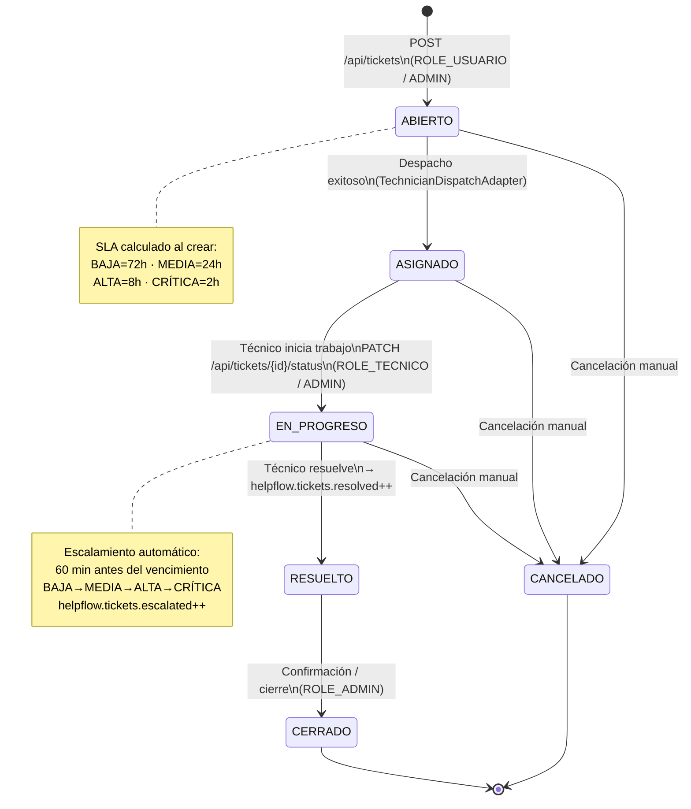

# HelpFlow — Support Ticket System

> **Module 6 — Performance Assessment**  
> IT support ticket management system built with Spring Boot,
> hexagonal architecture, and two independent microservices.

---

## Table of Contents

1. [Overview](#overview)
2. [Architecture](#architecture)
3. [Services](#services)
4. [Domain Model](#domain-model)
5. [Ticket Lifecycle](#ticket-lifecycle)
6. [SLA Rules](#sla-rules)
7. [Security Model](#security-model)
8. [API Reference](#api-reference)
9. [Inter-service Communication](#inter-service-communication)
10. [Persistence](#persistence)
11. [Observability](#observability)
12. [Running with Docker Compose](#running-with-docker-compose)
13. [Local Development](#local-development)
14. [Seed Data](#seed-data)
15. [Running Tests](#running-tests)
16. [Local Development Prerequisites](#local-development-prerequisites)
17. [Diagrams](#diagrams)
18. [Design Decisions](#design-decisions)

---

## Overview

HelpFlow is a technical support platform that allows users to
register incident tickets, technicians to manage them, and
administrators to oversee and reassign. The system calculates SLA deadlines
based on priority, queries technician availability through a separate
service, and automatically escalates tickets approaching expiration.

**Core technologies:**

| Component | Version |
|---|---|
| Java | 17 (Docker) / 21 (local) |
| Spring Boot | 3.3.0 |
| PostgreSQL | 16 |
| Flyway | included in Spring Boot 3.3 |
| springdoc-openapi | 2.5.0 |
| MapStruct | 1.5.5.Final |
| jjwt | 0.12.6 |
| Testcontainers | 1.20.4 |
| Docker Compose | v2 |

---

## Architecture

The `support-ticket-service` follows **hexagonal architecture** (Ports & Adapters):

```
support-ticket-service/
├── domain/                          ← Core. No framework dependencies.
│   ├── model/                       ← Ticket, User, Technician, TicketHistory
│   │   └── enums/                   ← TicketStatus, TicketPriority, TicketCategory, Role, UserStatus
│   └── exception/                   ← DomainException, BusinessRuleException, InvalidTicketTransitionException…
│
├── application/
│   ├── port/in/                     ← Use case interfaces (CreateTicketUseCase, etc.)
│   └── port/out/                    ← Repository and external service interfaces
│   └── service/                     ← Use case implementations
│
└── infrastructure/
    ├── adapter/in/rest/             ← REST Controllers, DTOs, GlobalExceptionHandler (RFC 7807)
    ├── adapter/out/persistence/     ← JPA entities, Spring Data repos, MapStruct mappers
    ├── adapter/out/dispatch/        ← HTTP client to dispatch service
    ├── config/                      ← SecurityConfig, OpenApiConfig, SlaConfig, MetricsConfig
    └── security/                    ← JwtService, JwtAuthenticationFilter, UserDetailsServiceImpl
```

See visual diagram: [`docs/architecture-hexagonal.svg`](docs/architecture-hexagonal.svg)

### Applied principles

- The **domain** does not import Spring, JPA, or any framework.
- **Input ports** (`port/in`) are interfaces called by controllers.
- **Output ports** (`port/out`) are interfaces called by services; JPA implements them.
- **Adapters** translate between the external world and the domain using MapStruct.
- **Role-based security** is applied exclusively with `@PreAuthorize` on each method, not in the `SecurityFilterChain` (avoids ordering conflicts in Spring Security 6).

---

## Services

| Service | Port | Description |
|---|---|---|
| `support-ticket-service` | 8080 | Main API: tickets, users, technicians, JWT, SLA, metrics |
| `technician-dispatch-service` | 8081 | Simulated technician availability. No JPA or security. |
| PostgreSQL 16 | 5432 | Relational database. Flyway migrations V1–V4. |

---

## Domain Model

### Core entities

**Ticket**
- `id`, `userId`, `title`, `description`, `category`, `priority`
- `sede`, `affectedAsset`, `createdAt`, `slaDeadline`
- `status`, `assignedTechnicianId`
- Method `transitionTo(newStatus)` — validates transitions and throws `InvalidTicketTransitionException`
- Method `isNearSlaDeadline(thresholdMinutes)` — used by automatic escalation

**User**
- `id`, `document` (unique), `name`, `email` (unique), `password` (BCrypt)
- `sede`, `area`, `status` (ACTIVO/INACTIVO), `role`

**Technician**
- `id`, `document` (unique), `name`, `salary`, `affiliationDate`
- `status`, `sede`, `specialties` (Set of TicketCategory), `supportProfile`

**TicketHistory**
- `ticketId`, `previousStatus`, `newStatus`, `observation`, `changedBy`, `changedAt`
- Immutable record of each status change

### Domain values

```
TicketCategory : HARDWARE | SOFTWARE | RED | ACCESOS | OTRO
TicketPriority : BAJA | MEDIA | ALTA | CRÍTICA
TicketStatus   : ABIERTO | ASIGNADO | EN_PROGRESO | RESUELTO | CERRADO | CANCELADO
Role           : ROLE_USUARIO | ROLE_TECNICO | ROLE_ADMIN
UserStatus     : ACTIVO | INACTIVO
```

### Relationships

```
User      1 ──< N   Ticket
Ticket    1 ──< N   TicketHistory
Ticket    N >── 1   Technician  (nullable — may not be assigned)
Technician 1 ──< N  TechnicianSpecialties  (@ElementCollection)
```

---

## Ticket Lifecycle



---

## SLA Rules

Deadline dates are calculated when creating the ticket based on priority:

| Priority | SLA Hours | Escalation Threshold |
|---|---|---|
| BAJA | 72 h | 60 min before expiration |
| MEDIA | 24 h | 60 min before expiration |
| ALTA | 8 h | 60 min before expiration |
| CRÍTICA | 2 h | Does not escalate (already maximum) |

**Automatic escalation:**
- `@Scheduled` every 60 seconds (configurable with `helpflow.sla.escalation-check-ms`)
- If a ticket is within the threshold and is not CRÍTICA: increases priority one level
- Records in `ticket_history` with `changedBy = "SYSTEM"`
- Increments counter `helpflow.tickets.escalated`

**All SLA values are configurable** in `application.yml` under `helpflow.sla.*`. No values are hardcoded in the domain code.

---

## Security Model

### JWT stateless

- Login: `POST /auth/login` → returns JWT token (expires in 120 min by default)
- Each protected request must include: `Authorization: Bearer <token>`
- `JwtAuthenticationFilter` extracts the user from the token and places it in `SecurityContextHolder`
- No server-side session (`SessionCreationPolicy.STATELESS`)

### Roles and access

| Role | Can do |
|---|---|
| `ROLE_USUARIO` | Register, log in, create tickets, view **only their own tickets** |
| `ROLE_TECNICO` | View assigned tickets, update status of assigned tickets, view technicians |
| `ROLE_ADMIN` | Full access: all tickets, all users, reassignment, configuration |

### Rules by endpoint

| Method | Path | Required Role | Additional restriction |
|---|---|---|---|
| POST | `/auth/register` | public | — |
| POST | `/auth/login` | public | — |
| POST | `/api/tickets` | USUARIO, ADMIN | User must be ACTIVO |
| GET | `/api/tickets/my` | USUARIO, ADMIN | Only returns tickets of authenticated user |
| GET | `/api/tickets` | ADMIN | All tickets |
| GET | `/api/tickets/{id}` | authenticated | USUARIO: only if owner; ADMIN/TECNICO: any |
| PATCH | `/api/tickets/{id}/status` | TECNICO, ADMIN | Transition must be valid |
| POST | `/api/tickets/{id}/assign` | ADMIN | Manual reassignment to available technician |
| GET | `/api/users` | ADMIN | — |
| GET | `/api/users/{id}` | ADMIN | — |
| GET | `/api/technicians` | ADMIN | — |
| GET | `/api/technicians/{id}` | ADMIN, TECNICO | — |

### Security architecture

```
Incoming request
      │
      ▼
JwtAuthenticationFilter          ← extracts and validates token
      │
      ▼
SecurityFilterChain              ← only verifies authentication (any valid JWT)
      │
      ▼
@PreAuthorize on each method     ← controls roles (ROLE_ADMIN, ROLE_TECNICO, ROLE_USUARIO)
      │
      ▼
Ownership logic in code          ← USUARIO can only see their own tickets
```

**Why this separation:** Spring Security 6 evaluates URL rules in strict order. Having role rules both in `SecurityFilterChain` and `@PreAuthorize` can cause ordering conflicts (real bug that caused 403 on `GET /api/tickets/my`). The adopted solution: `SecurityFilterChain` only controls authentication vs. public routes; roles are controlled exclusively with `@PreAuthorize`.

### Swagger / OpenAPI

The **Authorize** button appears in Swagger UI because `OpenApiConfig` registers the `bearerAuth` (HTTP Bearer JWT) schema as a global `SecurityRequirement`. To use it:

1. Execute `POST /auth/login` and copy the `token` from the response
2. Click **Authorize** at the top of Swagger UI
3. Paste the token in the `bearerAuth` field (without the `Bearer` prefix)
4. Confirm — all subsequent requests will include the header automatically

---

## API Reference

### POST /auth/register

Register a new user and return a JWT.

```json
// Request
{
  "document": "CC12345678",
  "name": "Ana García",
  "email": "ana@empresa.com",
  "password": "MiPassword123!",
  "sede": "Bogotá",
  "area": "Contabilidad",
  "role": "ROLE_USUARIO"
}

// Response 200
{
  "token": "<jwt>",
  "email": "ana@empresa.com",
  "role": "ROLE_USUARIO"
}
```

### POST /auth/login

```json
// Request
{ "email": "ana@empresa.com", "password": "MiPassword123!" }

// Response 200
{ "token": "<jwt>", "email": "ana@empresa.com", "role": "ROLE_USUARIO" }
```

### POST /api/tickets *(USUARIO, ADMIN)*

```json
// Request
{
  "title": "PC does not turn on",
  "description": "PC at station 12 does not boot since this morning",
  "category": "HARDWARE",
  "priority": "ALTA",
  "sede": "Bogotá",
  "affectedAsset": "PC-BOG-012"
}

// Response 200 — ticket created and assigned (if dispatch available)
{
  "id": 1,
  "userId": 3,
  "title": "PC does not turn on",
  "category": "HARDWARE",
  "priority": "ALTA",
  "status": "ASIGNADO",
  "slaDeadline": "2026-10-28T06:00:00Z",
  "assignedTechnicianId": 1
}
```

### PATCH /api/tickets/{id}/status *(TECNICO, ADMIN)*

```json
// Request
{ "newStatus": "EN_PROGRESO", "observation": "Reviewing hardware" }

// Response 200 — updated ticket
```

### POST /api/tickets/{id}/assign *(ADMIN only)*

Manually reassign a ticket to an available technician based on specialty and current load.

```http
POST /api/tickets/5/assign
Authorization: Bearer <admin-token>
Content-Type: application/json
```

**Response 200** — ticket with new `assignedTechnicianId` and status `ASIGNADO`.

**Error responses:**
- `404 Not Found` — ticket does not exist
- `422 Unprocessable Entity` — no technician available for the ticket's category
- `422 Unprocessable Entity` — invalid state transition (e.g., from `CERRADO` to `ASIGNADO`)

### Errors — RFC 7807 ProblemDetail

All errors follow this format:

```json
{
  "type": "about:blank",
  "title": "Invalid State Transition",
  "status": 422,
  "detail": "Cannot transition from CERRADO to EN_PROGRESO",
  "instance": "/api/tickets/5/status",
  "timestamp": "2026-10-27T20:15:00Z",
  "traceId": "3fa85f64-5717-4562-b3fc-2c963f66afa6"
}
```

| Code | When it occurs |
|---|---|
| 400 | Bean Validation fails (required field, invalid format) |
| 401 | No token or token expired |
| 403 | Insufficient role or access to another user's ticket |
| 404 | Ticket, user, or technician not found |
| 422 | Invalid state transition or business rule violation |
| 500 | Unexpected error (logged with `log.error`) |

---

## Inter-service Communication

```
Client
  │
  │  POST /api/tickets  (Bearer JWT)
  ▼
support-ticket-service :8080
  │
  │  1. Validate active user  →  PostgreSQL
  │  2. Calculate SLA deadline
  │  3. Call dispatch service  ─────────────────────────────────────►
  │                                    POST /technician-dispatch              │
  │                                    { ticketId, categoria, prioridad }     │
  │                                                                           ▼
  │                                                            technician-dispatch-service :8081
  │                                                            Deterministic hash (ticketId+cat+prio)
  │                                                            → same input = same technician always
  │  4. Receives: tecnicoId, disponibilidad, tiempoEstimadoHoras  ◄─────────────
  │  5. INSERT ticket (ASIGNADO) + INSERT ticket_history  →  PostgreSQL
  │  6. tickets.created++ (Micrometer)
  ▼
Response to client  { ticket ASIGNADO }
```

**Resilience:** if the dispatch service does not respond, the ticket is created as
`ABIERTO` without assignment. There is no explicit `@CircuitBreaker`; the error is captured
in `TechnicianDispatchAdapter` and propagated as `RuntimeException`, which
`CreateTicketService` handles leaving the ticket in `ABIERTO`.

**Determinism:** the dispatch service calculates a hash of `ticketId + categoria + prioridad`.
The same combination always returns the same technician and estimated time.

**Availability classification:**
- 0–2 hours → ALTA
- 3–8 hours → MEDIA
- More than 8 hours → BAJA

See visual diagram: [`docs/microservices-communication.svg`](docs/microservices-communication.svg)

---

## Persistence

### Schema (Flyway)

| Migration | Content |
|---|---|
| `V1__schema.sql` | Tables `users`, `technicians`, `technician_specialties`, `tickets` |
| `V2__asignaciones_historial_sla.sql` | Table `ticket_history`, indexes on `user_id`, `technician_id`, `status`, `sla_deadline` |
| `V3__datos_iniciales.sql` | User and technician seed data (admin, technician, user) |
| `V4__fix_seed_passwords.sql` | Updates BCrypt hashes of seed users |

### N+1 Strategy

List queries use explicit `LEFT JOIN FETCH` to avoid the N+1 problem:

```java
// JpaTicketRepository — queries with JOIN FETCH
@Query("SELECT t FROM TicketEntity t LEFT JOIN FETCH t.user LEFT JOIN FETCH t.technician WHERE t.user.id = :userId")
List<TicketEntity> findByUserId(@Param("userId") Long userId);

@Query("SELECT t FROM TicketEntity t LEFT JOIN FETCH t.user LEFT JOIN FETCH t.technician")
List<TicketEntity> findAll();
```

Additionally, `TicketEntity` has `@NamedEntityGraph` to load history
when needed.

### Transactionality

`CreateTicketService.create()` and `UpdateTicketStatusService.updateStatus()` are
annotated with `@Transactional`. The `INSERT` of the ticket and the `INSERT` of the history
occur in the same transaction — if any fails, a full rollback is performed.

---

## Observability

### Health checks

```bash
# General status
curl http://localhost:8080/actuator/health

# Liveness (for Kubernetes / Docker healthcheck)
curl http://localhost:8080/actuator/health/liveness

# Readiness
curl http://localhost:8080/actuator/health/readiness
```

### Business metrics

All metrics use low-cardinality tags (no ticket or user IDs).

| Metric | Type | When incremented |
|---|---|---|
| `helpflow.tickets.created` | Counter | Each time a ticket is successfully created |
| `helpflow.tickets.escalated` | Counter | Each ticket escalated by the SLA scheduler |
| `helpflow.tickets.resolved` | Counter | Each time a ticket moves to RESUELTO status |
| `helpflow.dispatch.calls` | Counter | Each call to the dispatch service |
| `helpflow.auth.failures` | Counter | Each `AuthenticationException` in the global handler |
| `helpflow.access.denied` | Counter | Each `AccessDeniedException` in the global handler |

```bash
# View all HelpFlow metrics
curl http://localhost:8080/actuator/metrics | python -m json.tool | grep helpflow

# View a specific counter
curl http://localhost:8080/actuator/metrics/helpflow.tickets.created

# Prometheus format
curl http://localhost:8080/actuator/prometheus | grep helpflow
```

### Evidence of metrics in operation

To generate real activity in counters:

```bash
# 1. Successful login + create ticket → tickets.created increments
# 2. Try to access /api/tickets without token → auth.failures does not increase (401 comes from filter, not handler)
# 3. Use ROLE_USUARIO token in GET /api/tickets → access.denied increases
# 4. Wait 60s with a ticket near SLA → tickets.escalated increases
# 5. Move ticket to RESUELTO → tickets.resolved increases
```

---

## Running with Docker Compose

### Prerequisites

- Docker Desktop installed and active
- Ports 5432, 8080, and 8081 available

### Quick start

```bash
# 1. Copy environment file
cp .env.example .env

# 2. Edit .env — set a strong JWT_SECRET (minimum 32 characters)
# Never commit .env to version control

# 3. Start all services
docker compose up --build

# 4. Verify everything is healthy
docker compose ps

# 5. Swagger UI of main service
open http://localhost:8080/swagger-ui.html

# 6. Swagger UI of dispatch service
open http://localhost:8081/swagger-ui.html
```

### Rebuild without losing data

If only the code of `support-ticket-service` changed:

```bash
# Rebuild only that image
docker compose build support-ticket-service

# Recreate only that container (does not touch DB or dispatch)
docker compose up -d --no-deps support-ticket-service
```

### Environment variables

| Variable | Default value | Description |
|---|---|---|
| `JWT_SECRET` | (required) | HMAC key for signing JWT. Minimum 32 characters. |
| `JWT_EXPIRATION_MINUTES` | 120 | Token duration in minutes |
| `DATABASE_URL` | `jdbc:postgresql://db:5432/helpflow` | PostgreSQL connection URL |
| `DATABASE_USER` | `helpflow` | PostgreSQL user |
| `DATABASE_PASSWORD` | (required) | PostgreSQL password |
| `DISPATCH_URL` | `http://technician-dispatch-service:8081` | Dispatch service URL |
| `DB_POOL_SIZE` | 5 | Maximum size of HikariCP connection pool |

---

## Local Development

### technician-dispatch-service (no database)

```bash
cd technician-dispatch-service
mvn spring-boot:run
# Available at http://localhost:8081
# Swagger at http://localhost:8081/swagger-ui.html
```

### support-ticket-service (requires PostgreSQL)

Option A — start only the database with Docker:

```bash
docker compose up db -d
```

Option B — use locally installed PostgreSQL (adjust credentials).

```bash
cd support-ticket-service

# Minimum required variables
export JWT_SECRET=change-this-to-a-long-random-secret-at-least-32-characters
export DATABASE_URL=jdbc:postgresql://localhost:5432/helpflow
export DATABASE_USER=helpflow
export DATABASE_PASSWORD=helpflow_dev

mvn spring-boot:run
# Available at http://localhost:8080
```

---

## Seed Data

Migrations V3 and V4 create the following initial users:

| Email | Password | Role | Sede |
|---|---|---|---|
| `admin@helpflow.com` | `Admin1234!` | ROLE_ADMIN | Bogotá |
| `tecnico@helpflow.com` | `Admin1234!` | ROLE_TECNICO | Bogotá |
| `usuario@helpflow.com` | `Admin1234!` | ROLE_USUARIO | Medellín |

Also creates a technician with document `TEC001`, specialties `RED` and `HARDWARE`.

> Passwords are stored as BCrypt hashes (strength 10). Change them
> after first deployment in any non-local environment.

---

## Running Tests

### Unit and web layer tests (no Docker)

```bash
cd support-ticket-service

mvn test -Dtest="TicketTransitionTest,CreateTicketServiceTest,EscalateTicketsServiceTest,SecurityRoleTest"
```

| Class | Coverage | Tests |
|---|---|---|
| `TicketTransitionTest` | Domain state machine — all valid and invalid transitions | 4 |
| `CreateTicketServiceTest` | Use case: active user, inactive user, user not found | 3 |
| `EscalateTicketsServiceTest` | Priority escalation, mixed batch, CRÍTICA does not escalate, counter | 6 |
| `SecurityRoleTest` | Roles in MockMvc: USUARIO, ADMIN, anonymous; ownership restriction in GET /{id} | 12 |

### Integration test (requires PostgreSQL running)

```bash
cd support-ticket-service

# With docker-compose PostgreSQL (port 5432 free)
mvn test -Dtest="TicketIntegrationTest"

# If port 5432 is occupied by another instance, use a bridge:
docker run -d --name pg-bridge --network pruebadedesempeo_sb_default -p 5433:5432 alpine/socat TCP-LISTEN:5432,fork TCP:db:5432
mvn test -Dtest="TicketIntegrationTest" -Ddocker.db.ip=localhost -Ddocker.db.port=5433
docker rm pg-bridge -f
```

The `TicketIntegrationTest` verifies against real PostgreSQL 16 with Flyway active:
1. `POST /auth/register` → HTTP 200, token in response
2. `GET /api/tickets/my` with JWT ROLE_USUARIO → HTTP 200 *(fix of the 403 bug)*
3. `GET /api/tickets` with JWT ROLE_USUARIO → HTTP 403 *(admin-only remains restricted)*
4. `GET /api/tickets/my` without token → HTTP 401

### Complete suite

```bash
mvn test -Dtest="TicketTransitionTest,CreateTicketServiceTest,EscalateTicketsServiceTest,SecurityRoleTest,TicketIntegrationTest" \
         -Ddocker.db.ip=localhost -Ddocker.db.port=5433
# Expected result: Tests run: 26, Failures: 0, Errors: 0
```

---

## Local Development Prerequisites

### Testcontainers on Windows with Docker Desktop 29.2.1+

Testcontainers uses the `docker-java` library, which negotiates API version 1.30 by default. Docker Desktop 29.2.1+ increased the minimum supported API to 1.44, causing HTTP 400 Bad Request errors when Testcontainers tries to connect.

**Solution:** Create a user-level configuration file that forces the correct API version:

1. Create or edit the file at `%USERPROFILE%\.docker-java.properties` (Windows)
2. Add the following line:
   ```
   api.version=1.44
   ```
3. Save the file — no restart needed.

**Alternative paths:**
- Linux/macOS: `~/.docker-java.properties`
- Global configuration: No project code changes required — this is a local environment setup.

**Verification:** After creating this file, `TicketIntegrationTest` will connect successfully and show in logs:
```
Connected to docker: Server Version: 29.7.2, API Version: 1.55
```

**Note:** This file is **not** included in the repository (it's user-specific). It's equivalent to installing Docker itself — a prerequisite for running integration tests with Testcontainers.

## Postman API Testing

Ready-to-use Postman collections are available in the `docs/postman/` directory for testing both services.

### Available Collections:

| File | Description |
|---|---|
| `helpflow-local.postman_environment.json` | Environment variables for local development |
| `support-ticket-service.postman_collection.json` | Collection for main ticket service API |
| `technician-dispatch-service.postman_collection.json` | Collection for technician dispatch service |

### How to Import:

1. **Open Postman** and click the **Import** button
2. Select the three JSON files from `docs/postman/`
3. **Set the active environment** to "HelpFlow Local"
4. **Update credentials** in the environment (passwords are seeded in the database)

### Environment Variables:

| Variable | Default Value | Description |
|---|---|---|
| `base_url` | `http://localhost:8080` | Main service URL |
| `dispatch_url` | `http://localhost:8081` | Dispatch service URL |
| `jwtToken` | *(auto-set)* | JWT token saved after login |
| `admin_email` | `admin@helpflow.com` | Admin user email |
| `admin_password` | `Admin1234!` | Admin password |
| `usuario_email` | `usuario@helpflow.com` | Regular user email |
| `usuario_password` | `Admin1234!` | User password |
| `tecnico_email` | `tecnico@helpflow.com` | Technician email |
| `tecnico_password` | `Admin1234!` | Technician password |
| `created_ticket_id` | *(auto-set)* | ID of created ticket |

### Recommended Testing Workflow:

1. **Start the services:**
   ```bash
   docker compose up --build
   ```

2. **Import collections** into Postman as described above

3. **Run the Login request** (under Authentication → Login) to obtain a JWT token
   - The test script automatically saves the token to the `jwtToken` environment variable

4. **Execute requests in order:**
   - Create Ticket
   - Get My Tickets
   - Get Ticket by ID
   - Update Ticket Status (requires TECNICO or ADMIN token)
   - Reassign Ticket (ADMIN only)

5. **Test the dispatch service** with different ticket parameters

### Collection Features:

- **Authentication flow:** Login saves JWT token automatically
- **Role-based testing:** Different credentials for USUARIO, TECNICO, ADMIN roles
- **Test scripts:** Validates HTTP status codes and response formats
- **Environment variables:** Clean separation of configuration from requests
- **Deterministic testing:** Dispatch service responses are predictable

### Testing Both Roles:

To test different roles, update the email/password in the Login request:
- **Admin:** `admin@helpflow.com` / `Admin1234!`
- **Technician:** `tecnico@helpflow.com` / `Admin1234!`
- **User:** `usuario@helpflow.com` / `Admin1234!`

**Note:** The collections use the seeded credentials from Flyway migrations V3/V4. Change passwords in production environments.

---

## Diagrams

### Hexagonal Architecture


### Ticket Lifecycle


### Inter-service Communication


---

## Design Decisions

### 1. `SecurityFilterChain` only verifies authentication

**Problem:** having role rules in the `SecurityFilterChain` (e.g., `hasAnyRole("USUARIO")` for `/api/tickets/my`) **and** in `@PreAuthorize` created ordering conflicts in Spring Security 6.2+. The endpoint `GET /api/tickets/my` returned 403 to users with valid `ROLE_USUARIO`.

**Solution:** the `SecurityFilterChain` only distinguishes public routes from routes requiring authentication. Roles are controlled exclusively with `@PreAuthorize` on each controller method.

**Result:** predictable behavior, no rule duplication, easy to audit.

### 2. SLA configured as `@ConfigurationProperties`

SLA values (hours per priority, escalation threshold, scheduler interval) are in `application.yml` under `helpflow.sla.*` and injected via `SlaConfig`. No business values are hardcoded in Java code.

### 3. Dispatch does not block ticket creation

If the `technician-dispatch-service` is down, the ticket is created in state `ABIERTO` without assignment. The operation does not fail. The administrator can manually assign later. This prioritizes availability over immediate consistency.

### 4. `JOIN FETCH` instead of `@EntityGraph`

Explicit JPQL with `LEFT JOIN FETCH` was chosen over `@EntityGraph` because it is more readable, easier to understand in a code review, and avoids the N+1 problem without implicit magic.

### 5. RFC 7807 ProblemDetail

All errors follow the RFC 7807 standard with extended fields `timestamp` and `traceId`. The `traceId` is a UUID generated per request, sufficient to correlate errors in logs without introducing a full distributed tracing system.

### 6. Passwords with BCrypt strength 10

Passwords are stored with BCrypt (cost factor 10). Hash of seed data are pre-calculated in Flyway migrations (V3 + V4), avoiding the application needing write permissions to the database to initialize test data.

### 7. Manual ticket reassignment endpoint

**Requirement:** The original assignment specified "Administrator: full access, reassignment and SLA configuration."

**Implementation:** A dedicated `POST /api/tickets/{id}/assign` endpoint restricted to `ROLE_ADMIN` was added to the `TicketController`. It calls the existing `AssignTicketUseCase` which:
1. Finds the ticket (404 if not found)
2. Selects an available technician based on specialty and current load (422 if none available)
3. Transitions ticket to `ASIGNADO` (422 if invalid transition)
4. Records the change in `ticket_history`

The endpoint is covered by 4 new tests in `SecurityRoleTest` verifying:
- `ROLE_ADMIN` → 200 OK
- `ROLE_USUARIO` → 403 Forbidden
- `ROLE_TECNICO` → 403 Forbidden
- Anonymous → 401 Unauthorized

**Result:** Complete fulfillment of the reassignment requirement with proper security, error handling, and test coverage.